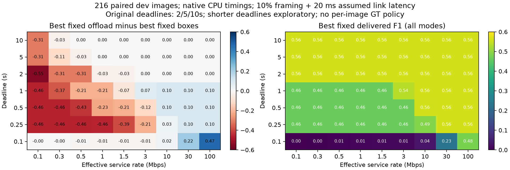

# Delivered F1 objective — all existing modes

No new detector, codec measurement, GPU, training, dataset or holdout evaluation. Native paired CPU stages from 216 images / 30 filename groups.

**Original deadlines 2/5/10s:** 0/27 cells have an offloading advantage above 1e-4 F1. Maximum difference: +0.000010. Completion-time savings alone do not increase this objective. These cells are parameter combinations, not independent trials; repeated deadline rows are not extra evidence.

All source-image/JPEG choices are included, plus optimistic pruned-box F1 controls. F1 is zero on a late result. Tied modes within 1e-4 are reported together; completion time is a separate quantity, not a reward term.

| Mbps | Deadline s | Best fixed modes (including ties) | Best F1 | Offload minus box |
|---:|---:|---|---:|---:|
| 1 | 0.5 | nano_boxes, nano_boxes_pruned_bound | 0.4625 | -0.2297 |
| 3 | 0.5 | nano_boxes, nano_boxes_pruned_bound | 0.4625 | -0.1204 |
| 10 | 0.5 | large_original | 0.5582 | +0.0957 |
| 30 | 0.5 | large_original | 0.5608 | +0.0983 |
| 1 | 1 | nano_boxes, nano_boxes_pruned_bound | 0.4625 | -0.2111 |
| 3 | 1 | large_jpeg70 | 0.5357 | +0.0732 |
| 10 | 1 | large_original | 0.5608 | +0.0983 |
| 30 | 1 | large_original | 0.5608 | +0.0983 |
| 1 | 2 | large_boxes, large_boxes_pruned_bound | 0.5608 | -0.0284 |
| 3 | 2 | large_boxes, large_original, large_boxes_pruned_bound | 0.5608 | +0.0000 |
| 10 | 2 | large_boxes, large_original, large_boxes_pruned_bound | 0.5608 | +0.0000 |
| 30 | 2 | large_boxes, large_original, large_boxes_pruned_bound | 0.5608 | +0.0000 |

## Completion time at 3 Mbps / 2 s (reported independently)

| Mode | Delivered F1 | On-time fraction | Completion p50 / p95 s |
|---|---:|---:|---:|
| nano_boxes | 0.4625 | 1.000 | 0.121 / 0.141 |
| large_boxes | 0.5608 | 1.000 | 1.145 / 1.212 |
| large_jpeg70 | 0.5357 | 1.000 | 0.457 / 0.653 |
| large_original | 0.5608 | 1.000 | 0.534 / 0.851 |
| large_jpeg10 | 0.2514 | 1.000 | 0.181 / 0.227 |

## Exploratory task-gain region

Descriptive filter: gain >=0.02 delivered F1 over the strongest box controls and positive in >=2/3 groups. No blind-test or publication claim.

| Mbps | Deadline s | Best offload | F1 gain | Positive group fraction |
|---:|---:|---|---:|---:|
| 30 | 0.1 | large_jpeg10 | +0.2192 | 0.800 |
| 100 | 0.1 | large_original | +0.4659 | 0.833 |
| 10 | 0.25 | large_jpeg70 | +0.0270 | 0.667 |
| 30 | 0.25 | large_original | +0.0983 | 0.733 |
| 100 | 0.25 | large_original | +0.0983 | 0.733 |
| 10 | 0.5 | large_original | +0.0957 | 0.733 |
| 30 | 0.5 | large_original | +0.0983 | 0.733 |
| 100 | 0.5 | large_original | +0.0983 | 0.733 |
| 3 | 1 | large_jpeg70 | +0.0732 | 0.733 |
| 10 | 1 | large_original | +0.0983 | 0.733 |
| 30 | 1 | large_original | +0.0983 | 0.733 |
| 100 | 1 | large_original | +0.0983 | 0.733 |

**Decision:** A useful latency/quality frontier is not by itself a task-utility advantage. Offloading has task-gain cells only under exploratory tighter deadlines in this grid. Do not open correction for the original objective merely because JPEG is faster. No correction, mobility or RL is executed here.

Limits:
- Native workstation CPU plus reused GPU reference, not UAV/network end-to-end measurement.
- Rate/deadline cells are parameter combinations, not independent trials; identical results at 2/5/10s do not provide three independent confirmations.
- All results are reused development images and sequence proxies; deadlines below 2s are exploratory.
- Family optimum is best fixed mode on the dataset, not GT-guided selection per image.
- 1e-4 F1 tie tolerance avoids treating CPU/GPU rounding as a substantive advantage.
- Pruned box control keeps F1 but may change AP; zero serialization is an optimistic bound for boxes.
- Completion times include late packets without clipping; no arbitrary weighted reward.
- Power assumptions unchanged; no new energy measurement or correctness claim for generative recovery.
- Bootstrap reselects the best fixed mode within each family per group resample; pointwise exploratory intervals, no multiple-testing claim.
- Gap to original-image F1 is a reference difference, not a mathematical upper bound on every correction algorithm.

Reproduce: `python swarmbridge/experiments/active_recovery/delivered_objective.py REPO`. Full per-mode completion times and delivered scores: per_mode.csv; all winners: summary.json.
