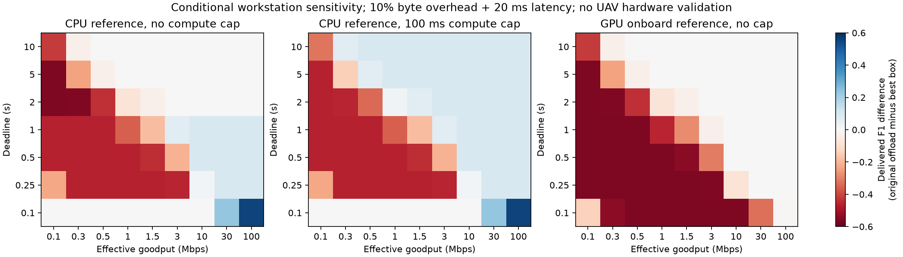

# Offloading: conditional feasibility from existing results

No new inference, GPU, training, data or channel trace. Gate A is **inconclusive for deployment**, not proof that offloading is useless.

Q70 ideal break-even with local large: **0.974 Mbps** (mean bytes / median processing approximation).
Per-image break-even with local large:

| Offload | Ideal rate p50/p90 Mbps | With 10% byte overhead, p50 Mbps |
|---|---:|---:|
| large_original | 1.194 / 1.771 | 1.313 |
| large_jpeg70 | 0.980 / 1.380 | 1.078 |

Reference scenarios use 10% byte overhead and 20 ms common latency. Missed deadlines/compute budgets get F1=0, no prior receiver result.

| Scenario | Mbps | nano delivered F1 | large-box F1 | original offload F1 | Q70 offload F1 |
|---|---:|---:|---:|---:|---:|
| CPU reference, original deadlines | 3 | 0.4625 | 0.5608 | 0.5608 | 0.5357 |
| CPU reference, exploratory 0.5s | 3 | 0.4625 | 0.0000 | 0.2524 | 0.3617 |
| CPU reference, exploratory 0.5s, faster link | 10 | 0.4625 | 0.0000 | 0.5608 | 0.5357 |
| CPU reference, 100ms compute allowance | 3 | 0.4625 | 0.0000 | 0.5608 | 0.5357 |
| GPU onboard reference | 3 | 0.4625 | 0.5608 | 0.5608 | 0.5357 |

At 3 Mbps and a 2s deadline, CPU-reference median total latency:

| Mode | Total p50 / p95 s |
|---|---:|
| nano_boxes | 0.109 / 0.115 |
| large_boxes | 1.096 / 1.098 |
| large_original | 0.514 / 0.831 |
| large_jpeg10 | 0.161 / 0.204 |
| large_jpeg70 | 0.438 / 0.632 |

Paired check on the **eight CPU-timed images (one filename group)**, same 3 Mbps / 2s assumptions:

| Mode | Delivered mean F1 | Total p50 / p95 s |
|---|---:|---:|
| nano_boxes | 0.5235 | 0.111 / 0.117 |
| large_boxes | 0.7027 | 1.096 / 1.181 |
| large_original | 0.7027 | 1.251 / 1.423 |
| large_jpeg10 | 0.4178 | 0.197 / 0.221 |
| large_jpeg70 | 0.6622 | 0.614 / 0.681 |

On this paired subset, original-image offload is slower than local large at 3 Mbps, while Q70 is faster with some quality loss. This illustrates why average payload and eight reference CPU timings do not establish per-image or cross-scene feasibility.

At 3 Mbps, no platform baseline, offloading uses less UAV-normalized energy than local large if incremental Pcompute/Pradio exceeds:
- large_original: 0.434
- large_jpeg70: 0.344

These are assumed-power thresholds, not power measurements. Hover/platform energy and energy budgets are separate sensitivity axes in energy_sweep.json.

Conclusion: CPU-limited and/or tight-deadline scenarios can justify offloading. GPU-capable onboard inference can reverse the result. Actual onboard compute/power and radio conditions remain unresolved. This justifies retaining offloading as a candidate, not opening correction or RL.

Limitations:
- No new detector, hardware, channel or energy measurement.
- Dev216 CPU scenarios assign median from eight CPU samples; not 216 paired CPU measurements.
- Paired8 contains only one filename group; cannot support flight/generalization statistics.
- JPEG encode+decode charged to UAV together, conservative; source-file stat I/O excluded.
- Resize, box serialization timing, response, queue, beam/pilot and protocol overhead not independently measured; nuisance overhead is assumed.
- Effective goodput is not PHY bitrate; no mobility or channel policy simulated.
- Incremental power ratios are sensitivity parameters; no measured joules or full-system energy claim.
- Energy is required energy of a completed attempt; failed/deadline-truncated attempt consumption is not modeled. Platform duration is separately swept as until-result vs fixed 2s.
- Best fixed diagnostics use dev labels for offline assessment, not online mode selection.
- Exploratory short deadlines and compute caps are not original-protocol or blind test evidence.
- No correction, semantic recovery, mobility advantage or RL necessity established.

Reproduce: `python swarmbridge/experiments/active_recovery/feasibility.py REPO` in the active-recovery WSL environment.
