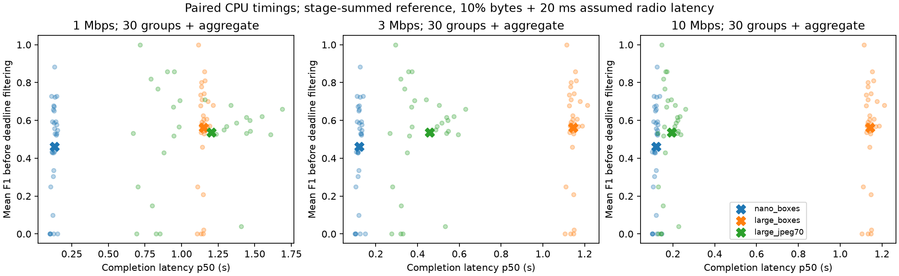

> Objective check: [maximum delivered F1 with all existing modes](../delivered_objective/summary.md). A latency-quality frontier alone is not a task-utility gain; original 2/5/10s deadlines show no substantive offload F1 gain.

# Gate A: paired CPU across 30 dev groups

216 images, two CPU timing repeats/model/image, 30 filename groups. No training or holdout scoring.

| Mode | Mean F1 | UAV compute p50/p95 ms | Reference total at 3 Mbps, 2s p50/p95 s | On-time fraction |
|---|---:|---:|---:|---:|
| nano_boxes | 0.4625 | 97.1 / 112.1 | 0.121 / 0.141 | 1.000 |
| large_boxes | 0.5608 | 1123.0 / 1190.7 | 1.145 / 1.212 | 1.000 |
| large_jpeg70 | 0.5357 | 18.9 / 25.4 | 0.457 / 0.653 | 1.000 |
| large_original | 0.5608 | 0.0 / 0.0 | 0.534 / 0.851 | 1.000 |

**Original-grid stable tradeoff:** True. Requires JPEG to remain nondominated in quality/p50-latency on >=2/3 groups, at two adjacent tested goodputs and an original deadline. This is descriptive development evidence.

| Goodput Mbps | Deadline s | Fraction of groups with nondominated JPEG |
|---|---:|---:|
| 1.5 | 2 | 0.667 |
| 1.5 | 5 | 0.667 |
| 1.5 | 10 | 0.667 |
| 3 | 2 | 0.667 |
| 3 | 5 | 0.667 |
| 3 | 10 | 0.667 |
| 10 | 2 | 0.667 |
| 10 | 5 | 0.667 |
| 10 | 10 | 0.667 |
| 30 | 2 | 0.933 |
| 30 | 5 | 0.933 |
| 30 | 10 | 0.933 |
| 100 | 2 | 1.000 |
| 100 | 5 | 1.000 |
| 100 | 10 | 1.000 |

Repeat-specific stability (same criterion, without averaging timings): [True, True].
Timing repeat absolute relative difference p50/p95: {'nano_boxes': {'median_absolute_relative_difference': 0.12942884279473488, 'p95_absolute_relative_difference': 0.31747589924040703}, 'large_boxes': {'median_absolute_relative_difference': 0.04623323977677388, 'p95_absolute_relative_difference': 0.13605649425390734}}. CPU F1 is unchanged between repeats.
Original-file offload is also retained as a fourth control in summary.json; the primary three-mode criterion alone does not prove Q70 beats every codec.
Nondominated means a quality-latency tradeoff, not higher accuracy than local large or an RL benefit.
Additional strong box control: discard scores <0.25 (no F1 change) and assume zero serialization cost. Stable cells: [{'rate_mbps': 1.5, 'deadline_s': 2, 'group_fraction': 0.6666666666666666}, {'rate_mbps': 1.5, 'deadline_s': 5, 'group_fraction': 0.6666666666666666}, {'rate_mbps': 1.5, 'deadline_s': 10, 'group_fraction': 0.6666666666666666}, {'rate_mbps': 3, 'deadline_s': 2, 'group_fraction': 0.6666666666666666}, {'rate_mbps': 3, 'deadline_s': 5, 'group_fraction': 0.6666666666666666}, {'rate_mbps': 3, 'deadline_s': 10, 'group_fraction': 0.6666666666666666}, {'rate_mbps': 10, 'deadline_s': 2, 'group_fraction': 0.6666666666666666}, {'rate_mbps': 10, 'deadline_s': 5, 'group_fraction': 0.6666666666666666}, {'rate_mbps': 10, 'deadline_s': 10, 'group_fraction': 0.6666666666666666}, {'rate_mbps': 30, 'deadline_s': 2, 'group_fraction': 0.9}, {'rate_mbps': 30, 'deadline_s': 5, 'group_fraction': 0.9}, {'rate_mbps': 30, 'deadline_s': 10, 'group_fraction': 0.9}, {'rate_mbps': 100, 'deadline_s': 2, 'group_fraction': 1.0}, {'rate_mbps': 100, 'deadline_s': 5, 'group_fraction': 1.0}, {'rate_mbps': 100, 'deadline_s': 10, 'group_fraction': 1.0}]. This is a favorable bound for boxes, not an extra hardware measurement.

Paired cluster-bootstrap 95% intervals (fixed 3 Mbps / 2s; pointwise, not blind confirmatory):

- nano_boxes, Q70_minus_mode_F1: 0.0732 [0.0342, 0.1117].
- nano_boxes, Q70_minus_mode_latency_s: 0.3297 [0.2734, 0.3764].
- large_boxes, Q70_minus_mode_F1: -0.0251 [-0.0323, -0.0169].
- large_boxes, Q70_minus_mode_latency_s: -0.6958 [-0.7519, -0.6522].

**Decision:** Stable conditional tradeoff on workstation reference. Keep offloading only as a conditional candidate; actual UAV feasibility and semantic correction remain unresolved. No mobility or RL opened.

Limits:
- 216 dev images and two CPU repeats; this is not an onboard device/power measurement.
- CPU results are rescored; receiver GPU predictions/timing are reused and immutable. No new GPU inference.
- Latency is a sum of separately measured stages plus assumed constant goodput/overhead, not a network end-to-end measurement.
- Image source is already stored JPEG; camera encoding, sensing and disk I/O are outside the starting point.
- CPU four threads on workstation; no claimed embedded equivalence or guaranteed thermal/power behavior.
- Filename groups are sequence proxies, not verified independent flights.
- Frontier uses mean F1 and p50 latency; group-wise results, p95 and deadline delivery are reported separately.
- Cluster CIs are pointwise descriptive on reused dev, not grid-wide significance tests or a blind test.
- Shorter deadlines and imposed compute budgets remain exploratory. Primary stability uses native timings and original 2/5/10s deadlines.
- Power ratios unchanged from sensitivity; no measured joules and no claim of semantic recovery or RL benefit.

Reproduce measurement: `bash scripts/active_recovery/run_paired_cpu.sh` (CPU-only, resumable).
Reproduce analysis: `python swarmbridge/experiments/active_recovery/analyze_paired.py REPO`.
